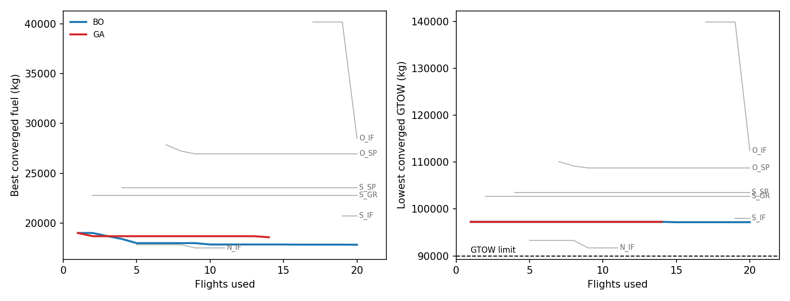
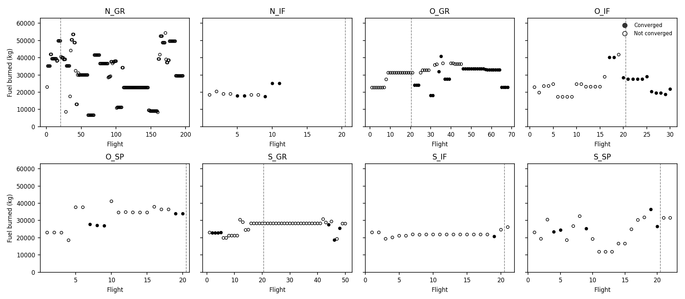
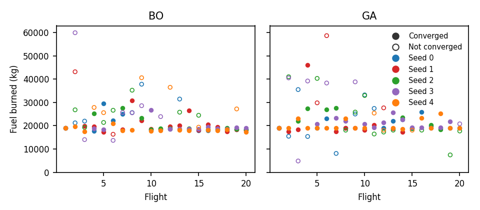

# MAS combinations vs optimizers at an equal flight budget (B = 20)

Compiled 2026-11-01. **Partial:** the optimizer sweep is still running. Bayesian optimization (BO) is complete
(5 seeds). GA has 4 seeds complete; seed 1 had 14 flights when this was written. MADS, SLSQP and random search have
not started. Re-run the script below when the sweep ends; the tables and figures regenerate.

Combinations: S / O / N = sequential / orchestrated / networked; SP / IF / GR = staged pipeline / iterative
feedback / graph-routed.

## Why compare per flight

One optimizer iteration flies several designs (PSO and GA about 6, SLSQP 11 for one finite-difference gradient),
while one MAS link flies about one. Comparing per link or per iteration therefore favours the optimizers. Following
WAFER (Song, Michalek, McComb; github.com/Chani-song/WAFER), every method is compared per simulator evaluation
under the same fixed budget.

## Setup

- **Budget unit = a flight:** one Aviary `run_simulation` that succeeded and burned more than 100 kg of fuel.
  SU2, meshing, mass and pyCycle calls are not charged, because the agents were not charged for them either.
  Tool counts per method are in `eval_counts.py`.
- **Budget:** B = 20 flights per optimizer run, 5 seeds per optimizer. A design that does not fly uses no budget.
  A run also stops after 40 designs sent through the pipeline. A design proposed twice is answered from a cache:
  it is not re-run and not counted again.
- **Optimizers** (WAFER configurations): BO (Ax 1.3.1, 5 Sobol initialisation trials), GA (pymoo 0.6.2,
  population 5), MADS (NOMAD 4.5.1), SLSQP (scipy, forward differences) and random search. All start from the
  agents' starting design, use the same 10 variables and bounds as the agents, and run the same coupled pipeline.
- **Objective:** the paper's penalised loss (WAFER eq. D1): fuel, plus 1e6 + 1e5 G when GTOW is over 90,000 kg.
- **Mission residuals (B236):** BO, GA, MADS and SLSQP also receive Aviary's range residual (NM) and mass
  residual (lbm) as constraints (residual ≤ 1 NM / 100 lbm). This gives them the information the agents read in
  the `run_simulation` output, as numbers instead of text. The residuals come from aviary-mcp branch
  `feat/optimizer-mission-residuals`, an optimizer-only version that returns them on every run. The agents saw them
  only when a mission did not converge, and only if they were among the 5 largest violations.
- **MAS flights:** each combination's single 20-link chain, read in order (link 1 to 20; inside a link, in the
  order of the knowledge base). Its first 20 flights are compared with each optimizer seed's 20 flights. N_IF made
  only 11 flights in 20 links.

## Main point: no method met the GTOW limit

No converged flight from any method reached GTOW ≤ 90,000 kg; only two unconverged GA flights did. The lowest
converged GTOW is 91,701 kg (N_IF); the starting design is at 97,263 kg. Best feasible fuel is therefore empty for
every method. Three values are reported instead:

1. best fuel among **converged** flights (GTOW ignored)
2. lowest GTOW among converged flights (how close a method got to the limit)
3. best fuel among **all** flights, converged or not (shown for completeness; see the caution below)

The paper loss is in `data/09_budget_compare_at_20_flights.csv`, but it should not be used for ranking. Every
flight carries the 1e6 GTOW penalty. The only flights under the limit were two unconverged GA missions, which the
loss (no convergence check, as in D1) ranks best.

## Converged flights, after 20 flights

Optimizers: mean over seeds, with the range over seeds in brackets.

| Method | Flights | Best converged fuel (kg) | Lowest converged GTOW (kg) |
|---|---|---|---|
| MAS N_IF | 11 | 17,521 | 91,701 |
| BO | 20 | 17,841 (17,364–18,446) | 97,191 |
| GA (seed 1 at 14) | 14–20 | 18,476 (17,395–19,020) | 97,097 |
| MAS S_IF | 20 | 20,741 | 97,984 |
| MAS S_GR | 20 | 22,811 | 102,672 |
| MAS S_SP | 20 | 23,554 | 103,555 |
| MAS O_SP | 20 | 26,953 | 108,754 |
| MAS O_IF | 20 | 28,513 | 112,433 |
| MAS O_GR | 20 | no converged flight | – |
| MAS N_GR | 20 | no converged flight | – |

- On converged fuel, BO and GA beat every MAS combination except N_IF. N_IF matches BO's better seeds with
  11 flights.
- N_IF is the only method that moved GTOW close to the limit. The optimizers stay near the starting design's
  97,263 kg.



## Where the best fuel came from (first 20 flights)

Flight = position in the method's flight sequence. MAS link = the chain link that flight belongs to.

| Combination | Converged flights | Best fuel, any (kg) | flight / link | Best converged fuel (kg) | flight / link |
|---|---|---|---|---|---|
| S_SP | 5 | 11,824 (unconverged) | 11 / 11 | 23,554 | 4 / 4 |
| O_IF | 3 | 17,302 (unconverged) | 6 / 6 | 28,513 | 20 / 12 |
| N_IF | 5 | 17,521 | 9 / 18 | 17,521 | 9 / 18 |
| O_SP | 5 | 18,521 (unconverged) | 4 / 4 | 26,953 | 9 / 9 |
| S_IF | 1 | 19,355 (unconverged) | 3 / 3 | 20,741 | 19 / 18 |
| S_GR | 4 | 19,867 (unconverged) | 6 / 2 | 22,811 | 2 / 1 |
| O_GR | 0 | 22,664 (unconverged) | 1 / 1 | – | – |
| N_GR | 0 | 22,998 (unconverged) | 1 / 1 | – | – |

| Optimizer, seed | Converged flights | Best fuel, any (kg) | flight | Best converged fuel (kg) | flight |
|---|---|---|---|---|---|
| BO 0 | 15 | 17,723 | 4 | 17,723 | 4 |
| BO 1 | 17 | 16,320 (unconverged) | 6 | 17,364 | 5 |
| BO 2 | 13 | 18,268 | 16 | 18,268 | 16 |
| BO 3 | 13 | 13,699 (unconverged) | 6 | 18,446 | 5 |
| BO 4 | 14 | 17,403 | 20 | 17,403 | 20 |
| GA 0 | 12 | 8,095 (unconverged) | 7 | 19,014 | 20 |
| GA 1 (14 flights) | 11 | 17,395 | 14 | 17,395 | 14 |
| GA 2 | 9 | 7,455 (unconverged) | 19 | 18,432 | 18 |
| GA 3 | 14 | 4,852 (unconverged) | 3 | 19,020 | 1 |
| GA 4 | 17 | 18,081 (unconverged) | 15 | 18,516 | 14 |

**Caution on "best fuel, any":** almost every low value comes from a mission that did not converge. These missions
stopped short of their range, so they burned less fuel because they flew less. Without the convergence filter, the
ranking flips: GA looks best by far, and S_SP becomes the best MAS combination.

## Fuel of every flown aircraft

Filled = the mission converged, hollow = it did not. Both figures use the same fuel axis.





- **Optimizers:** they spread widely over the first ~10 flights (5,000–60,000 kg, many unconverged), then settle
  around 17,500–20,000 kg, mostly converged.
- **MAS re-flies identical designs.** The long flat rows are the same design flown again and again: N_GR flies
  ~22,700 kg about 35 times in a row (flights ~110–145), O_GR repeats one design about 12 times within its first 20
  flights, S_GR about 25 times. Each repeat counts as a MAS flight. A repeat proposed by an optimizer is answered
  from the cache and does not count. **Open question:** count identical MAS repeats once, as a second version of
  this comparison? It would move the graph-routed combinations a long way along the flight axis. It is a filter on
  the logs; nothing needs re-running.

## Other checks

- **SU2 aero not injected:** 5 optimizer designs had an SU2 lift coefficient outside Aviary's allowed range
  (0.05–1.0), so the SU2 drag was not passed to Aviary. None of them flew, so no flight in this comparison ran on
  Aviary's default drag polar (`data/09_optimizer_aero_not_injected.csv`).
- **BO relaunch (B236):** BO was restarted on 2026-10-31 at 19:50 to add the residual constraints. Each seed
  replayed its first 5 designs from the log, without re-running them. Those 5 records predate the residual field:
  converged missions get residual 0, unconverged ones get the reported value or the 1e6 fallback.
- **Unconverged flights are common on both sides:** the MAS's first 20 flights converged 0–5 times; the
  optimizers' converged 9–17 times.

## Files and reproduction

- Script: `analysis/link20/budget_compare.py` (tests: `tests/test_link20_budget_compare.py`).
- Data copied here: `data/09_budget_compare_at_20_flights.csv`, `data/09_where_best_fuel_first_20_flights.csv`,
  `data/09_optimizer_aero_not_injected.csv`. The per-flight series is on aipexws8:
  `~/Jessica/avion_analysis/out_20261028/budget_compare/budget_compare_series.csv`.
- Optimizer runs: aipexws8 `/data/Jessica/optimizer_budget/runs/<optimizer>/seed<k>/evaluations.jsonl`;
  W&B project `mas-aviary-optimizer-budget`.
- Optimizer code: MAS-Aviary branch `feat/optimizer-budget` (`scripts/optimizer_budget/`); aviary-mcp branch
  `feat/optimizer-mission-residuals`.

```
# aipexws8, from ~/Jessica/avion_analysis/code (Avion venv)
python -m analysis.link20.budget_compare --runs /data/Jessica/optimizer_budget/runs \
    --out ../out_20261028/budget_compare
```
